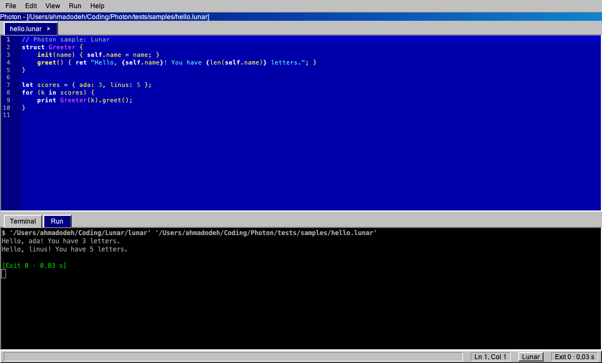

# Photon

A small 90s-styled code editor for [Lunar](https://github.com/ahmadodeh9000/Lunar),
C and Python, written in C on GTK3, GtkSourceView 4 and VTE. It runs on Linux
and macOS.



```
photon                  # open in the current directory
photon main.lunar       # open a file (it can be a new one)
photon ~/some/project   # open a folder, with the file tree shown
photon --run game.lunar # open a file and run it right away
```

---

## Features

- **Lunar, C and Python**: highlighting, comment toggle, indent rules,
  auto-closing brackets and quotes, autocomplete with each language's
  keywords and built-ins (plus words from your open files)
- **Run** the current file in an interactive Run tab: `input()`, `scanf` and
  `os.input()` work, and so do SDL windows. It shows the exit code and time
- **Error markers**: errors from Lunar (compile and runtime, including imported
  files), gcc/clang and Python get a red line and a gutter mark, with the
  message in the status bar. Photon jumps to the first one, opening its file
- **Tabs** with an unsaved `*` mark; the files you had open come back next time
- **Find / replace**, go to line, duplicate and move lines, smart Enter in `{}`
- **Terminal** tab with your own shell
- **Themes**: *Turbo 90s* (Windows 95 chrome around a Borland Turbo C++ blue
  code area, the default) and *VS Code Dark*, under View > Theme
- Zoom, auto save, a file tree that refreshes when you save

---

## Shortcuts

Cmd on macOS, Ctrl on Linux.

| Shortcut | Action |
|---|---|
| Cmd/Ctrl + N / O / S | New file (asks the language) / open / save |
| Cmd/Ctrl + Shift + S | Save as |
| Cmd/Ctrl + W | Close tab |
| Cmd/Ctrl + R or F5 | Run the current file |
| Cmd/Ctrl + . | Stop it |
| Cmd/Ctrl + F | Find |
| Cmd/Ctrl + Alt + F | Find and replace |
| Cmd/Ctrl + G / Shift + G | Next / previous match |
| Cmd/Ctrl + L | Go to line (`12` or `12:5`) |
| Cmd/Ctrl + / | Toggle comment (`//` or `#`) |
| Cmd/Ctrl + D | Duplicate line |
| Alt + Up / Down | Move line up / down |
| Cmd/Ctrl + B | Toggle the file tree |
| Cmd/Ctrl + \` or Cmd/Ctrl + T | Toggle the terminal |
| Cmd/Ctrl + + / - / 0 | Zoom in / out / reset |
| Cmd/Ctrl + Q | Quit (asks about unsaved files) |

On Linux, while a terminal has focus it gets Ctrl keys first (Ctrl+C, Ctrl+D,
Ctrl+R... work as in any terminal); use Ctrl+Shift+C / V to copy and paste there.

---

## Building

You need GTK3, GtkSourceView 4 and VTE development packages. `make deps`
prints the exact install command for your system:

```bash
# Debian / Ubuntu
sudo apt install build-essential pkg-config libgtk-3-dev libgtksourceview-4-dev libvte-2.91-dev

# Fedora
sudo dnf install gcc make pkgconf-pkg-config gtk3-devel gtksourceview4-devel vte291-devel

# Arch
sudo pacman -S --needed base-devel gtk3 gtksourceview4 vte3

# macOS (Homebrew, Apple Silicon or Intel)
brew install pkg-config gtk+3 gtksourceview4 vte3
```

```bash
git clone https://github.com/ahmadodeh9000/Photon
cd Photon
make            # finds Homebrew's pkg-config path on its own
./Photon
```

Nothing else needs installing: Photon loads `lang/` and `styles/` from next to
the binary. To install it system-wide (binary, language files, themes, icon,
and a `.desktop` entry on Linux):

```bash
sudo make install          # PREFIX=/usr/local by default; make uninstall undoes it
```

Other targets: `make test` (unit tests), `make check` (start, check, quit),
`make WERROR=1` (warnings are errors, as in CI).

### Running programs

- **Lunar**: Photon looks for `lunar` in `$LUNAR`, then in its settings, then in
  your `PATH`. If it can't find it, it asks once (Run > Locate Lunar... changes it).
- **Python**: `python3`, or `python` if there's no `python3`.
- **C**: `cc` (or `gcc`/`clang`) with `-Wall -g`; the binary goes to your temp
  folder. If there's a Makefile next to the file, Photon offers to run `make`.

### Fonts

The Turbo 90s theme uses a DOS font for code and a Windows 95 font for menus
if you have them installed, e.g. [Px437 IBM VGA 8x16](https://int10h.org/oldschool-pc-fonts/)
and Pixelated MS Sans Serif. Without them it uses Menlo / Tahoma / Geneva on
macOS and DejaVu on Linux, and still looks the part.

Settings live in `settings.ini` in your user config folder (`~/.config/photon`
on Linux).

---

## Adding a language

A language is **one entry** in `src/languages.c`:

```c
static const PhotonLanguage LANG_RUBY = {
    .id = "ruby", .name = "Ruby",
    .exts = { ".rb", NULL },
    .gsv_lang = "ruby",               // GtkSourceView highlighting id
    .run_cmd = "{ruby} {file}",       // run in the file's folder
    .comment = "#", .indent = 2,
    .pairs = "()[]{}\"\"''",          // auto-closing pairs
    .indent_after = "{[(",            // Enter after these indents
    .keywords = RUBY_WORDS,           // autocomplete words
    .error_parser = NULL,             // or one from src/errors.c
};
```

and add `&LANG_RUBY` to `LANGUAGES`. If GtkSourceView has no highlighting for
it, drop a `.lang` file in `lang/`; to run it with a new program, add one line
to `TOOLS` in `src/runner.c`. [docs/ARCHITECTURE.md](docs/ARCHITECTURE.md)
covers the details, plus how to add menu items, shortcuts and themes.

---

## Layout

```
src/                     C sources, one module per job (see docs/ARCHITECTURE.md)
lang/lunar.lang          Lunar syntax definition
styles/                  code color schemes: turbo90s.xml, vscode-dark.xml
icons/                   app icon
data/photon.desktop      Linux desktop entry
tests/                   unit tests and sample Lunar / C / Python files
Makefile                 one Makefile for Linux and macOS
```

---

## License

MIT
